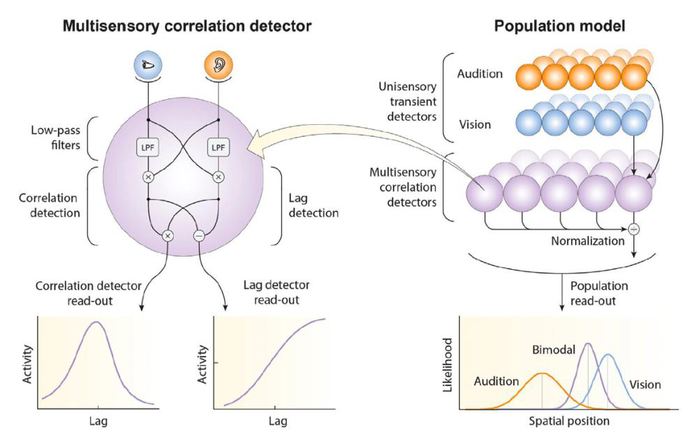
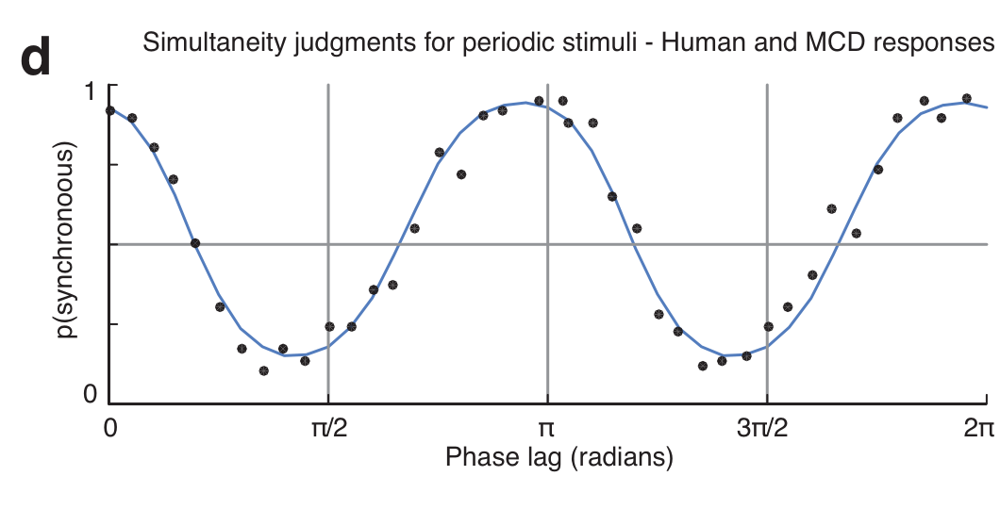

<!-- Reading copy of the implemented Multisensory Model page.
Media paths resolve when this file is kept beside index.html in the update package. -->

# Multisensory Correlation Detector

A biologically inspired model that turns images and sounds into predictions of what we perceive—and where we look.

## One mechanism. Many perceptual effects.

When someone speaks, their movements and voice change together. The **Multisensory Correlation Detector (MCD)** uses this shared structure to connect information across the senses.

Rather than starting with a description of a stimulus, the model processes the stimulus itself. From pixels and audio samples, it generates predictions about audiovisual timing, cue integration, perceptual illusions and attention. [[1]](https://elifesciences.org/articles/106122)

Watch: predicting where people look

[Open the gaze demonstration](assets/mcd/gaze.mp4)

The recorded conversation is shown above the model’s correlation map; coloured markers show measured gaze. The model highlights the active speaker without face recognition or speech recognition. Demonstration accompanying [Parise (2025)](https://elifesciences.org/articles/106122), using footage and eye-tracking data from Coutrot & Guyader (2015).

- 69 experiments simulated
- 3 species humans, rats and monkeys
- >0.97 reported mean model–data correlation

Results reported in the 2025 population-model paper. Correlation measures agreement with the data, not percentage accuracy. The model shares its sensory architecture across tests; task-specific parameters and species-specific temporal tuning are described [below](#what-was-fitted-and-what-does-the-model-not-claim). [[1]](https://elifesciences.org/articles/106122)

## What perception achieves is not yet how it works

Multisensory research has been strongly shaped by ideal-observer models, particularly maximum-likelihood estimation and Bayesian causal inference. In David Marr’s terms, these are primarily **computational-level accounts**: they explain the goals of perception, such as obtaining reliable estimates and deciding which signals belong together.

Their success leaves an important question open. **How are these computations performed on the sensory stream?** The influential cue-integration models typically begin with quantities such as location, reliability or audiovisual delay. Biological systems must first extract useful information from changing light and sound.

The MCD addresses this **algorithmic gap** by making the intermediate representations and transformations explicit. It does not reject the achievements of Bayesian models: it asks how behaviour consistent with those accounts can emerge from elementary operations on sensory signals. [[1]](https://elifesciences.org/articles/106122)

1. **Images & sounds** — The sensory input
2. **Detect changes** — Transient sensory responses
3. **Compare the senses** — Correlation and relative lag
4. **Read out the response** — Perceptual decisions or saliency

## A familiar circuit, a different question

The starting point is the **Hassenstein–Reichardt detector**, a classic model of motion vision. It compares signals from neighbouring visual locations after delaying one relative to the other. Its component operations have been studied extensively in insect neuroscience, providing a physiologically grounded starting point rather than an arbitrary mathematical construction.

We adapted this principle to compare inputs **across senses rather than across neighbouring points in an image**. Two complementary outputs indicate how strongly the signals are correlated and which modality leads. Temporal filtering and simple interactions between signals make both outputs evolve continuously over time. [[4]](https://doi.org/10.1038/ncomms11543)

The research programme is a test of sufficiency: **how much of multisensory perception can this minimal, biologically plausible mechanism explain?** The aim is not a separate model for every illusion, but a shared processing architecture tested against different stimuli, tasks and measures.

**From a local computation to a population.** Left: a detector provides correlation and lag read-outs. Right: spatially arranged detectors combine input from auditory and visual transient channels; normalisation supports a population estimate of location. Original artwork from Parise (2026), Figure 1. [[7]](https://www.researchgate.net/publication/400155988_A_new_look_at_audiovisual_perception_From_correlation_detection_to_a_general_theory_of_multisensory_integration)

### Watch the original detector in action

[Open the detector animation](assets/mcd/detector-animation.mp4)

The original MCD’s two outputs change as the relative timing of the inputs changes. Correlation is strongest near alignment; the lag signal distinguishes which sense leads. This silent animation accompanies Parise & Ernst (2016); later work refined the input stage to detect unsigned transients. [[4]](https://doi.org/10.1038/ncomms11543)

## Evidence, not just a plausible circuit

2012–2013

### Correlation matters beyond coincidence

Before developing the model, we tested whether the fine temporal structure of audiovisual signals affects integration. In a localisation task, the gain in precision matched the prediction for optimal integration only when the signals were temporally correlated—even though they occupied the same physical location in both conditions. A subsequent study showed the complementary cost: correlated signals made spatial discrepancies harder to detect. Correlation therefore promotes binding, not simply better performance on every task. [[2]](https://doi.org/10.1016/j.cub.2011.11.039) [[3]](https://doi.org/10.1163/22134808-00002417)

2016

### Predicting a percept, not recovering a label

The first MCD was tested with independently generated, random sequences of clicks and flashes. Observers judged whether the streams seemed to share a cause and which seemed to lead. These sequences did not supply a uniquely defined correct classification for the two streams as a whole. Success therefore required matching the stimulus features that shaped human judgements—not merely recovering an experimenter-assigned answer. Given the same sequences, the MCD reproduced the observed classification patterns. [[4]](https://doi.org/10.1038/ncomms11543)

2022

### Testing the computations against brain activity

In a magnetoencephalography (MEG) study, participants judged audiovisual sequences while their brain activity was recorded. A time-resolved encoding analysis linked the MCD’s dynamics to temporo-parietal responses. Correlation-related signals were evident across tasks; lag-related evidence was more task-dependent. This connects a model of behavioural judgements to the unfolding neural computations, rather than only to a final response. [[6]](https://doi.org/10.1038/s41467-022-29687-6)

2025

### What enters the detector? Changes, not sustained intensity

Two psychophysical experiments identified the importance of **unsigned transients**: changes in a signal, regardless of whether its intensity rises or falls. This matters because a shared event need not make light and sound intensities change in the same direction. The relevant evidence can be that something changes in both senses at the same time.

A striking prediction follows. For periodically modulated stimuli, both onsets and offsets provide matching events. Perceived synchrony can therefore peak **twice within one stimulus cycle**—when the signals are in phase and when they are half a cycle apart. Observers showed this frequency-doubling effect, and the transient-based MCD reproduced it. [[5]](https://elifesciences.org/articles/90841)

**Two synchrony peaks, one mechanism.** Dots: human judgements. Curve: MCD responses. The endpoints repeat the same phase; the second distinct maximum occurs halfway through the cycle. Cropped from Parise & Ernst (2025), Figure 5d. [[5]](https://elifesciences.org/articles/90841)

## From clicks and flashes to natural audiovisual scenes

A single detector compares two signals over time. A **lattice of detectors** extends the same operation across space: each unit compares local visual changes with auditory input. With spatialised sound, the sensory inputs have aligned receptive fields; with a mono soundtrack, the auditory envelope is shared across image locations. The architecture does not require lateral message-passing between detector units; a population normalisation is used for spatial estimation.

This makes the model **image- and sound-computable**. It can process the footage used in an experiment, rather than being supplied only with its nominal audiovisual delay or spatial discrepancy. The 2025 study tested this architecture across 69 experiments, spanning seven behavioural tasks and data from 534 humans, 110 rats and two monkeys. [[1]](https://elifesciences.org/articles/106122)

### Time

Synchrony and temporal-order judgements, temporal adaptation, and the dependence of audiovisual speech illusions on timing.

### Space

Reliability-weighted cue combination, the ventriloquist effect, and the integration or segregation of signals described by Bayesian causal inference.

### Attention

Audiovisual saliency maps that identify correlated regions of a scene and predict the distribution of gaze during natural viewing.

The important result is not just the number of successful fits. **The same low-level computations connect effects usually studied in separate paradigms.** Bayesian-like integration and aspects of attentional orienting emerge from a shared sensory mechanism, rather than from independent explanations for each phenomenon. [[1]](https://elifesciences.org/articles/106122)

### What was fitted, and what does the model not claim?

The population study estimated a common set of temporal-filter constants jointly across human timing experiments, with a separate, faster tuning for rats. These constants were then held fixed across additional tests. Depending on the simulation, 0–4 further parameters described task read-out or spatial uncertainty; the gaze analysis required no additional fitted parameters. The model is therefore *not* wholly parameter-free, and the reported mean correlation is not a held-out accuracy score for every experiment.

The speech simulations explain how audiovisual timing affects integration and the incidence of an illusion, not how a phoneme or word is recognised. The model does not currently include linguistic knowledge or top-down expectations. Its breadth is demonstrated over the tested studies, not over every possible audiovisual phenomenon. [[1]](https://elifesciences.org/articles/106122)

## Illusions without a specialised illusion mechanism

These demonstrations show the model’s responses to the audiovisual material itself. No face detector, lip tracker or speech recogniser is needed to compute the maps. Play with sound to experience the stimuli; browser playback is illustrative, not a calibrated psychophysical test. [[1]](https://elifesciences.org/articles/106122)

### When seeing changes hearing

[Open the McGurk demonstration](assets/mcd/mcgurk.mp4)

**The McGurk illusion.** Mismatched lip movements and speech can change the syllable a listener reports. As audiovisual delay varies, the model’s correlation response changes with the likelihood of integration. The response concentrates around the mouth without recognising it as a mouth. The model predicts the timing dependence of the effect, not phoneme identity. Demonstration accompanying [Parise (2025)](https://elifesciences.org/articles/106122).

### When sound follows a visual source

[Open the ventriloquist demonstration](assets/mcd/ventriloquist.mp4)

**The ventriloquist effect.** The upper panel shows the scene; the panels below show the spatial and temporal distribution of correlation. The response follows the visual source whose movements match the soundtrack, including the dummy. It does not need to understand the performance. The dummy’s voice was pitch-shifted in post-production. Demonstration accompanying [Parise (2025)](https://elifesciences.org/articles/106122).

### A closer look: the response to natural speech

[Open the speech-processing demonstration](assets/mcd/speech.mp4)

The video, correlation map and lag map are shown side by side. Traces below show the stimuli, transient responses and detector outputs as the audiovisual delay changes. This makes the intermediate processing visible, not just the final prediction. Demonstration accompanying [Parise (2025)](https://elifesciences.org/articles/106122).

## Distance compensation without calculating distance

Sound takes longer than light to reach an observer. In a classic experiment, Alais & Carlile (2005) found that subjective audiovisual alignment shifted with perceived source distance, approximately as expected from sound propagation. The result was interpreted in terms of estimating distance and compensating for the associated acoustic travel time. [[8]](https://pubmed.ncbi.nlm.nih.gov/15668388/)

The MCD reproduces this shift **without an explicit distance estimate or a stored speed of sound**. The explanation lies in the auditory envelope: in the tested reverberant stimuli, increasing distance weakens the direct onset relative to the reverberant tail. The sound becomes less front-loaded, changing the evidence received by the lag detector.

**In the stimulus:** Direct onset weakens relative to the reverberant tail

**In the detector:** The temporal balance of sensory evidence shifts

**In the prediction:** The point of subjective alignment shifts

All four distance conditions were fitted with **one shared set of decision parameters**, while the temporal filters were held fixed. The separation between the curves therefore arose from the stimulus waveforms, not a different delay correction fitted to each distance. [[1]](https://elifesciences.org/articles/106122)

The broader lesson: structure already present in a sensory signal can support behaviour that appears to require an explicit physical calculation.

This demonstrates a sufficient signal-based explanation of the tested effect; it does not imply that the brain never represents distance. [See the stimuli, data and model predictions in Figure 2B.](https://elifesciences.org/articles/106122/figures#fig2)

## Work with the signals your system actually produces

For applied perception, stimulus computability changes what can be tested. Instead of specifying an abstract audiovisual mismatch, we can present a model with the actual content, inspect its intermediate responses, and ask how particular design choices might affect the experience.

### Perceptual evaluation & immersive interfaces

Use stimulus-specific predictions to investigate audiovisual timing, binding and salience in recordings or prototypes. The model can guide experimental comparisons and help identify which signal features drive a perceptual effect.

### Audiovisual localisation & spatial audio

Explore correspondence maps for associating sounds with visible sources. This offers a foundation for bespoke algorithms in audiovisual media, spatial audio and systems that must orient towards relevant events.

### Interpretable multimodal AI & robotics

A high response has a concrete explanation: local auditory and visual changes are correlated. Such a module could provide correspondence-based supervision for learning from unlabelled video, or an inspectable sensory front end for a larger system.

These directions follow from the model’s demonstrated ability to process audiovisual signals and generate interpretable correspondence maps. Its simple, local operations also motivate investigation of efficient implementations. Improved learning efficiency, real-time device performance and benefits in a particular product remain questions to test, not results established by the existing experiments. [[1]](https://elifesciences.org/articles/106122)

### Have an audiovisual problem to investigate?

I welcome collaborative R&D, bespoke algorithm development and model-based perceptual evaluation for immersive technologies, audiovisual systems and multimodal machine perception.

[Discuss an applied project](mailto:cesare.parise@liverpool.ac.uk)

## The research behind the model

[1] Key paper · Cesare V. Parise · eLife, 2025

### Correlation detection as a stimulus computable account for audiovisual perception, causal inference, and saliency maps in mammals

The population architecture, the 69-experiment evaluation, natural-scene demonstrations, assumptions and limitations. Full methods and MATLAB source code accompany the article.

[Read the paper and access the code](https://elifesciences.org/articles/106122)

### Foundations, experimental tests and perspective

2. **Parise, Spence & Ernst (2012).** [When correlation implies causation in multisensory integration.](https://doi.org/10.1016/j.cub.2011.11.039) *Current Biology.* The precision benefit of integrating temporally correlated signals.
3. **Parise, Harrar, Ernst & Spence (2013).** [Cross-correlation between auditory and visual signals promotes multisensory integration.](https://doi.org/10.1163/22134808-00002417) *Multisensory Research.* The corresponding cost: reduced sensitivity to spatial discrepancies.
4. **Parise & Ernst (2016).** [Correlation detection as a general mechanism for multisensory integration.](https://doi.org/10.1038/ncomms11543) *Nature Communications.* The original detector and behavioural tests with stochastic sequences.
5. **Parise & Ernst (2025).** [Multisensory integration operates on correlated input from unimodal transient channels.](https://elifesciences.org/articles/90841) *eLife.* The transient input stage and the frequency-doubling prediction.
6. **Pesnot Lerousseau, Parise, Ernst & van Wassenhove (2022).** [Multisensory correlation computations in the human brain identified by a time-resolved encoding model.](https://doi.org/10.1038/s41467-022-29687-6) *Nature Communications.* The bridge from model dynamics to MEG responses.
7. **Parise (2026).** [A new look at audiovisual perception: From correlation detection to a general theory of multisensory integration.](https://www.researchgate.net/publication/400155988_A_new_look_at_audiovisual_perception_From_correlation_detection_to_a_general_theory_of_multisensory_integration) *The Cognitive Psychology Bulletin*, issue 11. A narrative overview of the development of the framework.
8. **Alais & Carlile (2005).** [Synchronizing to real events: Subjective audiovisual alignment scales with perceived auditory depth and speed of sound.](https://pubmed.ncbi.nlm.nih.gov/15668388/) *Proceedings of the National Academy of Sciences.* The distance-and-synchrony experiment reproduced by the MCD.
